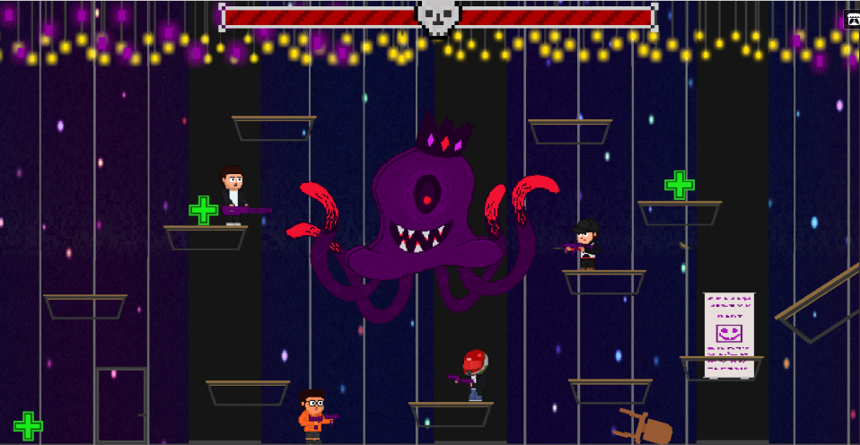

# Campus Anomaly

**Local 2-player co-op run-and-gun shooter for an arcade cabinet · Unity · Windows**

One day, an unexplained anomaly hits a university campus, and strange creatures take over the buildings. Two of four students have to fight their way through the campus, defeat the creatures and find out where the anomaly came from.

▶ **Download:** the Windows build is available under [Releases](../../releases). Extract the .rar file (with WinRAR or 7-Zip) and run `GameStudio3.exe`. You need two Xbox-compatible gamepads.

---

## My Role: Level Designer

- Adapted the **real interior spaces of İstinye University** into the game's levels, turning familiar halls and rooms into a campus overrun by the anomaly.
- Designed the game's levels for **two players sharing one screen**, so both characters always have room to move, dodge and shoot.
- Laid out the platforms and arenas for the **boss fights**, including the vertical, multi-platform Dottopus arena shown above.
- Placed and paced encounters with the **4 enemy types** and positioned health pickups to control the difficulty curve.
- Built each level around a different **character duo**, so the two levels play differently.

<!-- Edit this list so it matches exactly what you did. -->

## Features

- Local 2-player co-op (gamepad)
- 4 playable characters, each with its own mechanics
- 2 levels, each played with a different character duo
- 4 enemy types and 2 bosses
- Built to run on an arcade cabinet

## Details

| | |
|---|---|
| **Engine** | Unity 6 (URP 2D) |
| **Platform** | Windows / arcade cabinet |
| **Genre** | 2D run-and-gun shooter, boss battles |
| **Status** | Prototype |
| **Team** | Ali Kabataş (Unity development, game design), Yunus Emre Uludağ (level design), [other team members] |

> This repository is a portfolio showcase. It includes the playable Windows build; the source code belongs to the team and is not included here.

---

**Yunus Emre Uludağ** · Game Designer
[LinkedIn](https://www.linkedin.com/in/yunusemreuludag-gamedev/) · yunusemreuludagdev@gmail.com
